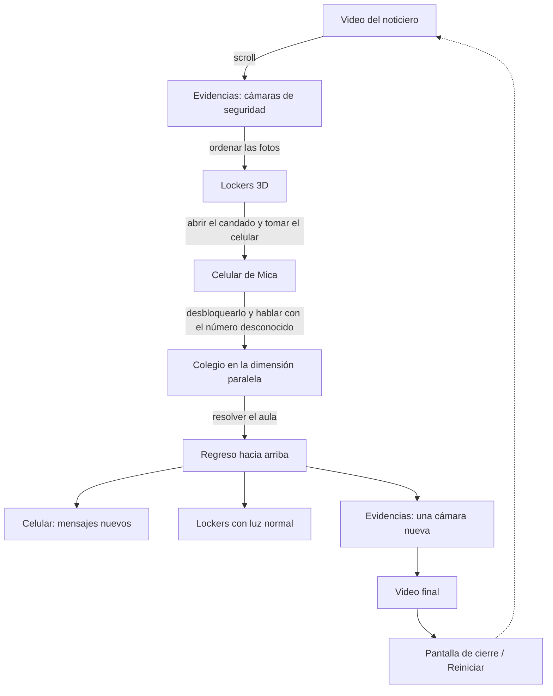

# Señal perdida

> Experiencia web transmedia de terror · Next.js + Three.js + Firebase
> TP6 — Programación III · UMAI · 2026

**Deploy:** https://web-transmedia.vercel.app/
**Repositorio:** https://github.com/camizalcman/web-transmedia

---

## Premisa

> Una alumna está desaparecida y la última vez que se la vio fue adentro del colegio. Hay fotos y evidencia de que estuvo ahí, pero nadie la vio salir y ninguna cámara registró su salida. Todos la están buscando.

## Concepto y sinopsis

*Señal perdida* es un relato paranormal de desaparición contado a través de diferentes evidencias: una nota en un noticiero, las grabaciones de las cámaras del colegio, un locker cerrado con candado y un celular que todavía tiene batería.

La experiencia empieza como empieza cualquier caso: con la noticia en la televisión. A partir de ahí la persona usuaria deja de mirar y empieza a investigar. Revisa las cámaras, encuentra el locker de Mica, logra abrirlo y recupera su celular. En los chats aparecen los últimos mensajes de Mica, cada vez más desesperados: las luces se apagaron, todo se volvió rojo, baja y baja escaleras y no llega nunca. Y entonces escribe un **número desconocido**.

Lo que sigue ya no ocurre del todo en este mundo. El colegio tiene otra versión, una dimensión paralela, y la única forma de sacar a Mica de ahí es recorrerla y entender lo que dejó escrito.

La interfaz es parte del relato: la página no deja avanzar hasta que se resuelve cada tramo, el celular funciona como un teléfono real y, cuando el caso se cierra, todo lo que ya se recorrió **cambia**: el regreso hacia arriba muestra un mundo distinto del que se dejó.

## Cómo se juega

La experiencia es un único recorrido vertical: **se avanza scrolleando hacia abajo**. Cada sección aparece recién cuando se resuelve la anterior, así que si la página "termina", todavía queda algo por hacer en la sección actual.

| Tramo | Qué hay | Qué se hace |
| --- | --- | --- |
| 1. El noticiero | Video a pantalla completa con la noticia de la desaparición. | Darle Play. Al terminar, aparece la flecha para bajar. |
| 2. Las evidencias | Las capturas de las cámaras de seguridad del colegio entran en escena con el scroll. | Mirarlas con atención: al final se acomodan en una grilla y hay que **arrastrarlas para ordenarlas**. |
| 3. Los lockers | Escena 3D con los lockers del colegio. Uno tiene candado. | Abrir puertas, revisar lo que hay adentro y encontrar el código del candado. |
| 4. El celular | El celular de Mica en 3D, con su pantalla funcionando. | Desbloquearlo, leer sus chats y **responderle al número desconocido** escribiendo libremente. Después aparece la flecha para bajar. |
| 5. La dimensión paralela | El colegio en primera persona, a oscuras y con luces rojas. | Recorrerlo (flechas del teclado o botones en pantalla) y resolver lo que pide el aula. |
| 6. El regreso | Todo lo anterior, transformado. | Volver hacia arriba siguiendo las flechas, revisar el celular y las evidencias, y ver el video final. |

Al terminar aparece una pantalla de cierre con la opción de **reiniciar** el caso desde el principio.

### Flechas que guían el recorrido

Cuando una sección ya está resuelta, una flecha animada indica hacia dónde seguir. Tienen la misma estética que la del video del comienzo, aparecen con un fundido y al tocarlas hacen el scroll solas.

| Sección | Flecha | Cuándo aparece | Lleva a |
| --- | --- | --- | --- |
| Video del noticiero | ↓ | En el segundo 30 del video (o al terminar) | Las evidencias |
| Evidencias | ↓ | Mientras las fotos entran en escena, hasta que forman la grilla | La grilla para ordenarlas |
| Celular | ↓ | 4 s después de hablar con el número desconocido | El colegio |
| Colegio | ↑ (aviso de mensajes sin leer) | Al resolver el aula | El celular |
| Celular, de regreso | ↑ | 6 s después de volver, cuando ya llegaron los mensajes nuevos | Los lockers |
| Lockers, de regreso | ↑ | 1,5 s después de llegar | Las evidencias |
| Evidencias, de regreso | ↑ | Junto con la foto nueva | El video final |

Los tiempos se ajustan en las constantes `DOWN_CUE_DELAY` y `UP_CUE_DELAY` de `PhoneScroll.js` y `UP_CUE_DELAY` de `LockerRoom.js`.

**Consejos sin spoilers**

- Nada es decorativo: las fotos, las hojas y los chats tienen información.
- El número desconocido entiende lo que se le escribe. Si no sabés qué hacer, preguntale.
- El sonido suma mucho: se maneja con el botón del parlante, fijo arriba a la derecha.
- Si querés empezar de cero, recargá la página (la conversación con el número desconocido se conserva; el botón de reinicio del final la borra).
- Tu investigación se guarda sola, sin registrarte. Con **Guardar progreso** (arriba a la izquierda) podés crear una cuenta o entrar con Google para no perderla y seguirla desde otro dispositivo.

## Mapa del recorrido



Estados de la historia (`lib/storyProgress.js`): `photos-ordered` → `phone-taken` → `phone-unlocked` → `contact-talked` → `school-solved` → `phone-returned`. Cada sección de la portada está envuelta en un `StoryGate` que la monta recién cuando se completa el paso correspondiente. Cada paso nuevo también se registra en Firebase (ver [Persistencia y Firebase](#persistencia-y-firebase)).

## Tecnologías

| Tecnología | Versión | Uso |
| --- | --- | --- |
| [Next.js](https://nextjs.org/) (App Router) | 16.4 | Rutas, metadata, Server y Client Components, fuentes. |
| [React](https://react.dev/) | 19.2 | Interfaz y estado de cada tramo. |
| [Three.js](https://threejs.org/) | 0.186 | Escenas 3D: lockers, celular y colegio. Implementado con Three.js directo (sin React Three Fiber). |
| [Firebase](https://firebase.google.com/) | 12.18 | Authentication (anónimo, Google y email) y Cloud Firestore con caché offline. |
| `next/font/google` | — | Tipografías Caveat y Rock Salt. |
| JavaScript (ES Modules) | — | Todo el proyecto está escrito en JavaScript, sin TypeScript. |

## Arquitectura

```text
app/
  layout.js                 # layout raíz y metadata general
  page.js                   # portada: el recorrido completo
  loading.js / error.js / not-found.js  # pantallas de carga, error y 404
  celular/page.js           # vista aislada del modelo del celular
  lockers/page.js           # vista aislada de la escena de los lockers
  globals.css               # sistema visual y responsive
components/
  Landing.js                # Server Component que arma el recorrido
  StoryGate.js              # muestra una sección cuando se completa un paso
  ScrollArrow.js            # flecha animada que guía el scroll entre secciones
  IntroVideo.js / EndVideo.js / PlayButton.js
  BackgroundMusic.js        # música de fondo y botón de sonido
  CloudStatus.js            # indicador REMOTO / OFFLINE / LOCAL y botón "Guardar progreso"
  AuthPanel.js              # panel de acceso (crear cuenta, ingresar, Google)
  EvidenceScroll.js         # evidencias con scroll y desafío de ordenarlas
  LockerRoom.js / LockerScene.js   # lockers 3D, candado y hoja con pistas
  PhoneScroll.js / PhoneModel.js / PhoneScreen.js  # celular 3D con pantalla HTML
  phone/                    # bloqueo, inicio, WhatsApp y chat con el número desconocido
  SchoolScroll.js / SchoolScene.js # colegio en primera persona y pizarrón
data/
  evidence.js               # evidencias, videos y configuración del desafío
  lockers.js                # pistas del candado (el código se calcula a partir de ellas)
  conversations.js          # chats del celular y epílogo
  dimension.js              # configuración del acertijo del colegio
lib/
  storyProgress.js          # pasos del recorrido y reinicio
  unknownContact.js         # motor de conversación del número desconocido
  shapeRecognizer.js        # reconocimiento de figuras dibujadas a mano
  firebase.js               # inicialización de Firebase (con caché offline de Firestore)
  cloudSave.js              # sesión, guardado de la investigación y estado de persistencia
firestore.rules             # reglas de acceso por usuario
public/
  img/ models/ music/ videos/
```

## Decisiones técnicas

**Un recorrido en una sola página.** La historia se cuenta como un descenso continuo. En lugar de cambiar de pantalla, cada tramo se monta debajo del anterior cuando se resuelve (`StoryGate`), así que no se puede scrollear hasta una sección que todavía no se ganó. Cuando la historia termina, las secciones ya vistas cambian de estado (luces, mensajes, una evidencia nueva) para que el regreso hacia arriba también sea parte del relato.

**Flechas guía.** Como el recorrido cambia de sentido (se baja hasta el colegio y después hay que volver hacia arriba), cada sección muestra una flecha cuando ya se resolvió. `ScrollArrow` es un único componente para todas, y `useDelayed` la hace aparecer unos segundos después del paso que la habilita (`contact-talked`, `phone-returned`, `school-solved`), así primero se ve lo que pasó y después hacia dónde seguir.

**Server y Client Components.** `Landing` es un Server Component: compone la página y carga las fuentes con `next/font`. Solo se hidratan las piezas que necesitan el navegador: videos, scroll, escenas Three.js, celular y música (`"use client"`).

**Three.js directo.** Cada escena (`LockerScene`, `PhoneModel`, `SchoolScene`) crea su propio `WebGLRenderer`, cámara y luces dentro de un `useEffect` y:

- anima con `requestAnimationFrame` y se pausa cuando la sección no está visible;
- ajusta el canvas al contenedor con `ResizeObserver`;
- limita el pixel ratio (`Math.min(devicePixelRatio, 2)`; 1.25 en el colegio, que es la escena más pesada);
- usa `Raycaster` para tocar puertas, candado y celular, y para detectar paredes al caminar;
- carga modelos `.glb` con `GLTFLoader`;
- libera geometrías, materiales, texturas, controles y renderer al desmontarse.

**Recursos desarrollados para el proyecto.**

- La pantalla del celular es una interfaz HTML (bloqueo, inicio, WhatsApp) proyectada sobre el modelo 3D.
- La hoja con las pistas del locker y el pizarrón se dibujan en un `canvas` y se usan como textura.
- `lib/shapeRecognizer.js` reconoce figuras dibujadas a mano con geometría (envolvente convexa, áreas inscriptas y redondez), sin servicios externos.
- `lib/unknownContact.js` es un pequeño motor de conversación: normaliza el texto, detecta la intención por palabras clave y responde según lo que ya se habló, sin usar APIs externas.
- El código del candado se calcula a partir de las cuentas escritas en `data/lockers.js`, de modo que cambiar las pistas cambia el código.

**Datos separados de los componentes.** Textos, chats, evidencias, tiempos y pistas viven en `data/`, así se puede ajustar la historia sin tocar la lógica.

**Persistencia.** El avance del recorrido vive en memoria a propósito: si se guardara y se restaurara, después de jugar una vez la página quedaría abierta de punta a punta. Lo que sí se guarda en Firebase es el registro de la investigación (qué expedientes se completaron, si se resolvió y el chat con el número desconocido) mediante `lib/cloudSave.js`. Ese registro no reabre el recorrido al recargar. Detalle en [Persistencia y Firebase](#persistencia-y-firebase).

## Accesibilidad y responsive

- Diseño adaptado a pantallas angostas (grilla de evidencias de 2 columnas, posiciones propias para mobile).
- El candado se resuelve desde un panel HTML con botones (no hace falta girar las ruedas en 3D).
- En el colegio hay controles táctiles en pantalla además de las flechas del teclado.
- `Escape` cierra los paneles abiertos; los controles tienen `aria-label`.
- Las flechas guía son botones con `aria-label` (por ejemplo "Volver a los lockers"). Mientras están ocultas no se pueden enfocar con el teclado, y con "reducir movimiento" activado en el sistema dejan de animarse.
- El indicador de guardado anuncia sus cambios a lectores de pantalla (`aria-live`) y los pasos del panel indican si están completados o pendientes.

## Instalación

Requiere **Node.js 20** o superior.

```bash
git clone https://github.com/camizalcman/web-transmedia.git
cd web-transmedia
npm install
npm run dev
```

Abrir [http://localhost:3000](http://localhost:3000).

Sin variables de entorno la experiencia funciona completa en modo local: el indicador muestra **LOCAL** y todo se guarda solo en el navegador.

### Scripts

```bash
npm run dev      # servidor de desarrollo
npm run build    # build de producción
npm run start    # ejecuta el build
npm run lint     # análisis estático
```

## Variables de entorno

Copiar `.env.example` como `.env.local` y completar:

| Variable | Obligatoria | Descripción |
| --- | --- | --- |
| `NEXT_PUBLIC_FIREBASE_API_KEY` | Para usar Firebase | Configuración de la Web App de Firebase. |
| `NEXT_PUBLIC_FIREBASE_AUTH_DOMAIN` | Para usar Firebase | |
| `NEXT_PUBLIC_FIREBASE_PROJECT_ID` | Para usar Firebase | |
| `NEXT_PUBLIC_FIREBASE_STORAGE_BUCKET` | Para usar Firebase | |
| `NEXT_PUBLIC_FIREBASE_MESSAGING_SENDER_ID` | Para usar Firebase | |
| `NEXT_PUBLIC_FIREBASE_APP_ID` | Para usar Firebase | |
| `NEXT_PUBLIC_INTRO_VIDEO_URL` | No | URL externa del video inicial. Por defecto `/videos/VideoIntro.mp4`. |
| `NEXT_PUBLIC_END_VIDEO_URL` | No | URL externa del video final. Por defecto `/videos/VideoFin.mp4`. |

Las variables `NEXT_PUBLIC_` quedan en el bundle del cliente: la seguridad de los datos depende de Firebase Authentication y de las reglas de Firestore, no de ocultar estas claves.

## Persistencia y Firebase

### Sesión y cuentas

Al entrar a la portada, `lib/cloudSave.js` inicia una **sesión anónima** de Firebase sin pedir nada: se puede jugar de punta a punta sin registrarse y la investigación igual queda guardada.

El botón **Guardar progreso** (arriba a la izquierda) abre el panel de acceso para:

- **crear una cuenta** con email y contraseña;
- **ingresar** con una cuenta existente;
- **entrar con Google**.

Desde la sesión anónima, crear una cuenta o entrar con Google por primera vez **vincula** la cuenta (`linkWithCredential` / `linkWithPopup`): el UID no cambia y lo jugado como invitado pasa a la cuenta. Si la cuenta de Google ya existía, se entra a ella. **Cerrar sesión** vuelve a una sesión anónima nueva.

La cuenta anónima queda atada a ese navegador; registrarse permite seguir la investigación desde otro dispositivo o navegador.

### Qué se guarda

| Dato | Cuándo se guarda |
| --- | --- |
| **Expedientes** (pasos 1 a 4) | Al ordenar las fotos de las cámaras, sacar el celular del locker, desbloquearlo y hablar con el número desconocido. En el panel se muestran solo como "Paso 1…4" para no adelantar el juego. |
| **Investigación resuelta** | Solo cuando el dibujo del pizarrón es correcto (`recognizeSequence(...).correct`). Un dibujo equivocado no la marca. |
| **Chat con el número desconocido** | Con cada mensaje, como mucho cada 1,5 s. Se guarda también en `localStorage`; si la copia de la nube es más nueva (otro dispositivo u otra cuenta), se usa esa. |

**Reiniciar juego**, en la pantalla final, borra el chat (local y en la nube). Los expedientes y la investigación resuelta se conservan. El atajo de desarrollo `?final` no registra nada.

### Estado de persistencia

El indicador fijo muestra dónde se está guardando. El punto funciona como el REC de una cámara:

| Estado | Punto | Significado |
| --- | --- | --- |
| **REMOTO** | rojo fijo | Guardado y confirmado en Firestore. |
| **SINCRONIZANDO** / **CONECTANDO** | rojo titilando | Hay cambios esperando confirmación, o se está iniciando la sesión. |
| **OFFLINE** | hueco | Sin conexión: Firestore guarda en el dispositivo (caché persistente en IndexedDB) y sube los cambios al volver la red. |
| **LOCAL** | gris | Sin configuración de Firebase, o la nube rechazó el acceso: se guarda solo en el navegador. |

El estado sale de los metadatos del documento (`onSnapshot` con `includeMetadataChanges`: `fromCache` y `hasPendingWrites`) y de los eventos `online` / `offline` del navegador.

### Configuración

1. Crear un proyecto y una Web App en Firebase Console.
2. En **Authentication → Sign-in method**, habilitar los proveedores **Anónimo**, **Google** y **Correo electrónico/contraseña**.
3. Crear una base **Cloud Firestore**.
4. Completar `.env.local` con la configuración de la Web App.
5. En **Firestore → Reglas**, reemplazar todo por el contenido de `firestore.rules` y publicar.
6. Reiniciar el servidor de desarrollo.

### Modelo de datos

```js
// games/{uid} — investigación de la portada (lib/cloudSave.js)
{
  userId: "uid-de-firebase-auth",
  authProvider: "anonymous" | "google.com" | "password",
  steps: ["photos-ordered", "phone-taken", ...],
  evidenceOrdered: true,   // paso 1
  phoneTaken: true,        // paso 2
  phoneUnlocked: false,    // paso 3
  contactTalked: false,    // paso 4
  solved: false,           // investigación resuelta (pizarrón)
  lastSolvedAt: Timestamp,
  unknownChat: { version, messages: [...], clues, talked, solved, savedAt, ... },
  updatedAt: serverTimestamp()
}

// users/{uid} — perfil
{
  userId: "uid-de-firebase-auth",
  email, displayName, photoURL, isAnonymous, authProvider,
  createdAt, lastLoginAt
}
```

### Reglas

El UID es a la vez el id del documento y el valor de `userId`. Las reglas exigen que ambos coincidan con `request.auth.uid`, así que cada persona solo puede leer y escribir sus propios datos. En `games` además:

- solo se aceptan los campos del modelo (un campo inventado se rechaza);
- `steps` es una lista de hasta 20 elementos y `solved` es booleano;
- el chat tiene como máximo 400 mensajes.

## Referencias

**Narrativas y de interacción**

- *Requiem for a Dream* — sitio web de la película (Hi-ReS!, 2000): la interfaz como parte del relato.
- *A Journal of Insomnia* (National Film Board of Canada, 2013): experiencia cuyo estado cambia según la interacción.
- La historia es original: no se basa en películas, series ni juegos.

**Visuales**

- Estética de cámaras de seguridad (CCTV), noticieros televisivos y ruido analógico.
- Interfaz de WhatsApp en iOS como referencia para la pantalla del celular.
- _(completar con referencias visuales propias)_

## Uso de inteligencia artificial

En este proyecto usé herramientas de IA como apoyo en el desarrollo:

- **Código:** usé Claude Code (Anthropic) como asistente para programar, buscar errores e intervenir los modelos 3D. Revisé, probé y ajusté cada cambio antes de incorporarlo.
- **Imágenes:** las capturas de las cámaras de seguridad se generaron con ChatGPT a partir de indicaciones propias. También con ChatGPT creé las imágenes que funcionan como primer y último fotograma de los videos de inicio y de fin.
- **Video:** los videos de inicio y de fin se realizaron con Adobe Firefly a partir de las imágenes creadas con ChatGPT. Después los edité manualmente en CapCut, y la voz se produjo con otro programa.

## Créditos

**Modelos 3D** — Sketchfab, licencia CC BY 4.0

- “School Locker” por Lee Studio
- “Combination Padlock” por RED2000
- “Old books” por Arkikon
- “Textured Books” por sydniekay
- “Stationery (pencil, pen and eraser)” por Mikhail Antonov
- “Ruler” por Artieee
- “School_[hallway]” por yuuuusukeeee
- “Japanese Classroom” por T I A N
- “Apple iPhone 13 Pro Max” por _(completar autor y licencia)_

**Tipografías** — Google Fonts, licencia SIL Open Font License

- Caveat
- Rock Salt

**Audio y video**

- Música de fondo (`music-horror.mp3`): _(completar autor, fuente y licencia)_
- Video inicial y video final: realizados con Adobe Firefly a partir de imágenes creadas con ChatGPT (ver [Uso de inteligencia artificial](#uso-de-inteligencia-artificial)).

**Imágenes**

- Capturas de las cámaras de seguridad (evidencias): producción propia, generadas con ChatGPT.
- Fondo de pantalla del celular: _(completar: producción propia / fuente)_

**Base técnica**

- El proyecto partió del boilerplate *SEÑAL 88* de la cátedra Programación III — UMAI. Su narrativa y sus pantallas (capítulos de `/archivo`, objeto 3D de ejemplo y su guía) se reemplazaron por completo por la historia de *Señal perdida*. Del boilerplate solo quedan la configuración base de Next.js y Firebase.

---

Proyecto con fines académicos · **Cátedra Programación III — UMAI**
