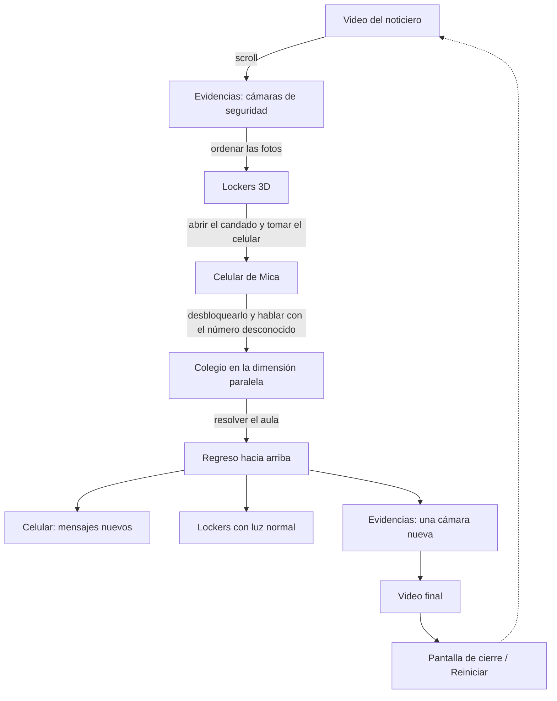

# Señal perdida

> Experiencia web transmedia de terror · Next.js + Three.js + Firebase
> TP6 — Programación III · UMAI · 2026

**Deploy:** _(completar con el enlace público)_
**Repositorio:** https://github.com/camizalcman/web-transmedia

---

## Premisa

> Una noche, Mica baja las escaleras del colegio para encontrarse con sus amigas y nunca llega a la salida: con las cámaras de seguridad, su celular y los mensajes de alguien que no debería poder escribir, tenés que descubrir dónde quedó atrapada y abrirle el camino de vuelta.

## Concepto y sinopsis

*Señal perdida* es un relato de desaparición contado a través de los restos digitales que dejó: un noticiero, las grabaciones de las cámaras del colegio, un locker cerrado con candado y un celular que todavía tiene batería.

La experiencia empieza como empieza cualquier caso: con la noticia en la televisión. A partir de ahí la persona usuaria deja de mirar y empieza a investigar. Revisa las cámaras, encuentra el locker de Mica, logra abrirlo y recupera su celular. En los chats aparecen los últimos mensajes de Mica, cada vez más desesperados: las luces se apagaron, todo se volvió rojo, baja y baja escaleras y no llega nunca. Y entonces escribe un **número desconocido**.

Lo que sigue ya no ocurre del todo en este mundo. El colegio tiene otra versión, una dimensión paralela, y la única forma de sacar a Mica de ahí es recorrerla y entender lo que dejó escrito.

La interfaz es parte del relato: la página no deja avanzar hasta que se resuelve cada tramo, el celular funciona como un teléfono real y, cuando el caso se cierra, todo lo que ya se recorrió **cambia**: el regreso hacia arriba muestra un mundo distinto del que se dejó.

## Cómo se juega

La experiencia es un único recorrido vertical: **se avanza scrolleando hacia abajo**. Cada sección aparece recién cuando se resuelve la anterior, así que si la página "termina", todavía queda algo por hacer en la sección actual.

| Tramo | Qué hay | Qué se hace |
| --- | --- | --- |
| 1. El noticiero | Video a pantalla completa con la noticia de la desaparición. | Darle Play. Al terminar, aparece la flecha para bajar. |
| 2. Las evidencias | Las capturas de las cámaras de seguridad del colegio entran en escena con el scroll. | Mirarlas con atención: al final se acomodan en una grilla y hay que **arrastrarlas para ordenarlas**. |
| 3. Los lockers | Escena 3D con los lockers del colegio. Uno tiene candado. | Abrir puertas, revisar lo que hay adentro y encontrar el código del candado. |
| 4. El celular | El celular de Mica en 3D, con su pantalla funcionando. | Desbloquearlo, leer sus chats y **responderle al número desconocido** escribiendo libremente. |
| 5. La dimensión paralela | El colegio en primera persona, a oscuras y con luces rojas. | Recorrerlo (flechas del teclado o botones en pantalla) y resolver lo que pide el aula. |
| 6. El regreso | Todo lo anterior, transformado. | Volver hacia arriba, revisar el celular y las evidencias, y ver el video final. |

Al terminar aparece una pantalla de cierre con la opción de **reiniciar** el caso desde el principio.

**Consejos sin spoilers**

- Nada es decorativo: las fotos, las hojas y los chats tienen información.
- El número desconocido entiende lo que se le escribe. Si no sabés qué hacer, preguntale.
- El sonido suma mucho: se maneja con el botón del parlante, fijo arriba a la derecha.
- Si querés empezar de cero, recargá la página (la conversación con el número desconocido se conserva; el botón de reinicio del final la borra).

## Mapa del recorrido



Estados de la historia (`lib/storyProgress.js`): `photos-ordered` → `phone-taken` → `phone-unlocked` → `contact-talked` → `school-solved` → `phone-returned`. Cada sección de la portada está envuelta en un `StoryGate` que la monta recién cuando se completa el paso correspondiente.

## Tecnologías

| Tecnología | Versión | Uso |
| --- | --- | --- |
| [Next.js](https://nextjs.org/) (App Router) | 16.4 | Rutas, metadata, Server y Client Components, fuentes. |
| [React](https://react.dev/) | 19.2 | Interfaz y estado de cada tramo. |
| [Three.js](https://threejs.org/) | 0.186 | Escenas 3D: lockers, celular y colegio. Implementado con Three.js directo (sin React Three Fiber). |
| [Firebase](https://firebase.google.com/) | 12.18 | Authentication y Cloud Firestore. |
| `next/font/google` | — | Tipografías Caveat y Rock Salt. |
| JavaScript (ES Modules) | — | Todo el proyecto está escrito en JavaScript, sin TypeScript. |

## Arquitectura

```text
app/
  layout.js                 # layout raíz y metadata general
  page.js                   # portada: el recorrido completo
  archivo/[chapter]/page.js # ruta dinámica
  celular/page.js           # vista aislada del modelo del celular
  lockers/page.js           # vista aislada de la escena de los lockers
  globals.css               # sistema visual y responsive
components/
  Landing.js                # Server Component que arma el recorrido
  StoryGate.js              # muestra una sección cuando se completa un paso
  IntroVideo.js / EndVideo.js / PlayButton.js
  BackgroundMusic.js        # música de fondo y botón de sonido
  EvidenceScroll.js         # evidencias con scroll y desafío de ordenarlas
  LockerRoom.js / LockerScene.js   # lockers 3D, candado y hoja con pistas
  PhoneScroll.js / PhoneModel.js / PhoneScreen.js  # celular 3D con pantalla HTML
  phone/                    # bloqueo, inicio, WhatsApp y chat con el número desconocido
  SchoolScroll.js / SchoolScene.js # colegio en primera persona y pizarrón
data/
  evidence.js               # evidencias, videos y configuración del desafío
  lockers.js                # pistas del candado (el código se calcula a partir de ellas)
  conversations.js          # chats del celular y epílogo
  dimension.js              # configuración del acertijo del colegio
lib/
  storyProgress.js          # pasos del recorrido y reinicio
  unknownContact.js         # motor de conversación del número desconocido
  shapeRecognizer.js        # reconocimiento de figuras dibujadas a mano
  firebase.js               # inicialización de Firebase
hooks/
  useProgress.js            # autenticación y persistencia en Firestore / localStorage
firestore.rules             # reglas de acceso por usuario
public/
  img/ models/ music/ videos/
```

## Decisiones técnicas

**Un recorrido en una sola página.** La historia se cuenta como un descenso continuo. En lugar de cambiar de pantalla, cada tramo se monta debajo del anterior cuando se resuelve (`StoryGate`), así que no se puede scrollear hasta una sección que todavía no se ganó. Cuando la historia termina, las secciones ya vistas cambian de estado (luces, mensajes, una evidencia nueva) para que el regreso hacia arriba también sea parte del relato.

**Server y Client Components.** `Landing` es un Server Component: compone la página y carga las fuentes con `next/font`. Solo se hidratan las piezas que necesitan el navegador: videos, scroll, escenas Three.js, celular y música (`"use client"`).

**Three.js directo.** Cada escena (`LockerScene`, `PhoneModel`, `SchoolScene`) crea su propio `WebGLRenderer`, cámara y luces dentro de un `useEffect` y:

- anima con `requestAnimationFrame` y se pausa cuando la sección no está visible;
- ajusta el canvas al contenedor con `ResizeObserver`;
- limita el pixel ratio (`Math.min(devicePixelRatio, 2)`; 1.25 en el colegio, que es la escena más pesada);
- usa `Raycaster` para tocar puertas, candado y celular, y para detectar paredes al caminar;
- carga modelos `.glb` con `GLTFLoader`;
- libera geometrías, materiales, texturas, controles y renderer al desmontarse.

**Recursos desarrollados para el proyecto.**

- La pantalla del celular es una interfaz HTML (bloqueo, inicio, WhatsApp) proyectada sobre el modelo 3D.
- La hoja con las pistas del locker y el pizarrón se dibujan en un `canvas` y se usan como textura.
- `lib/shapeRecognizer.js` reconoce figuras dibujadas a mano con geometría (envolvente convexa, áreas inscriptas y redondez), sin servicios externos.
- `lib/unknownContact.js` es un pequeño motor de conversación: normaliza el texto, detecta la intención por palabras clave y responde según lo que ya se habló, sin usar APIs externas.
- El código del candado se calcula a partir de las cuentas escritas en `data/lockers.js`, de modo que cambiar las pistas cambia el código.

**Datos separados de los componentes.** Textos, chats, evidencias, tiempos y pistas viven en `data/`, así se puede ajustar la historia sin tocar la lógica.

**Persistencia.** El avance del recorrido vive en memoria a propósito: si se guardara, después de jugar una vez la página quedaría abierta de punta a punta. La conversación con el número desconocido se guarda en `localStorage` para sobrevivir a una recarga. La autenticación y el progreso en la nube se manejan con `hooks/useProgress.js` (ver más abajo).

## Accesibilidad y responsive

- Diseño adaptado a pantallas angostas (grilla de evidencias de 2 columnas, posiciones propias para mobile).
- El candado se resuelve desde un panel HTML con botones (no hace falta girar las ruedas en 3D).
- En el colegio hay controles táctiles en pantalla además de las flechas del teclado.
- `Escape` cierra los paneles abiertos; los controles tienen `aria-label`.

## Instalación

Requiere **Node.js 20** o superior.

```bash
git clone https://github.com/camizalcman/web-transmedia.git
cd web-transmedia
npm install
npm run dev
```

Abrir [http://localhost:3000](http://localhost:3000).

Sin variables de entorno la experiencia funciona completa en modo local.

### Scripts

```bash
npm run dev      # servidor de desarrollo
npm run build    # build de producción
npm run start    # ejecuta el build
npm run lint     # análisis estático
```

## Variables de entorno

Copiar `.env.example` como `.env.local` y completar:

| Variable | Obligatoria | Descripción |
| --- | --- | --- |
| `NEXT_PUBLIC_FIREBASE_API_KEY` | Para usar Firebase | Configuración de la Web App de Firebase. |
| `NEXT_PUBLIC_FIREBASE_AUTH_DOMAIN` | Para usar Firebase | |
| `NEXT_PUBLIC_FIREBASE_PROJECT_ID` | Para usar Firebase | |
| `NEXT_PUBLIC_FIREBASE_STORAGE_BUCKET` | Para usar Firebase | |
| `NEXT_PUBLIC_FIREBASE_MESSAGING_SENDER_ID` | Para usar Firebase | |
| `NEXT_PUBLIC_FIREBASE_APP_ID` | Para usar Firebase | |
| `NEXT_PUBLIC_INTRO_VIDEO_URL` | No | URL externa del video inicial. Por defecto `/videos/VideoIntro.mp4`. |
| `NEXT_PUBLIC_END_VIDEO_URL` | No | URL externa del video final. Por defecto `/videos/VideoFin.mp4`. |

Las variables `NEXT_PUBLIC_` quedan en el bundle del cliente: la seguridad de los datos depende de Firebase Authentication y de las reglas de Firestore, no de ocultar estas claves.

## Configuración de Firebase

1. Crear un proyecto y una Web App en Firebase Console.
2. En **Authentication**, habilitar los proveedores **Anónimo**, **Google** y **Correo electrónico/contraseña**.
3. Crear una base **Cloud Firestore**.
4. Completar `.env.local` con la configuración de la Web App.
5. Publicar las reglas de `firestore.rules`.
6. Reiniciar el servidor de desarrollo.

### Modelo de datos

```js
// progress/{uid}
{
  userId: "uid-de-firebase-auth",
  authProvider: "anonymous" | "google.com" | "password",
  clues: [],
  updatedAt: serverTimestamp()
}

// users/{uid}
{
  userId: "uid-de-firebase-auth",
  email, displayName, photoURL, isAnonymous, authProvider,
  createdAt, lastLoginAt
}
```

El UID es a la vez el id del documento y el valor de `userId`. Las reglas exigen que ambos coincidan con `request.auth.uid`, así que cada persona solo puede leer y escribir sus propios datos.

## Referencias

**Narrativas y de interacción**

- *Requiem for a Dream* — sitio web de la película (Hi-ReS!, 2000): la interfaz como parte del relato.
- *A Journal of Insomnia* (National Film Board of Canada, 2013): experiencia cuyo estado cambia según la interacción.
- _(completar: películas, series o juegos de terror / dimensiones paralelas que inspiraron la historia)_

**Visuales**

- Estética de cámaras de seguridad (CCTV), noticieros televisivos y ruido analógico.
- Interfaz de WhatsApp en iOS como referencia para la pantalla del celular.
- _(completar con referencias visuales propias)_

## Créditos

**Modelos 3D** — Sketchfab, licencia CC BY 4.0

- “School Locker” por Lee Studio
- “Combination Padlock” por RED2000
- “Old books” por Arkikon
- “Textured Books” por sydniekay
- “Stationery (pencil, pen and eraser)” por Mikhail Antonov
- “Ruler” por Artieee
- “School_[hallway]” por yuuuusukeeee
- “Japanese Classroom” por T I A N
- “Apple iPhone 13 Pro Max” por _(completar autor y licencia)_

**Tipografías** — Google Fonts, licencia SIL Open Font License

- Caveat
- Rock Salt

**Audio y video**

- Música de fondo (`music-horror.mp3`): _(completar autor, fuente y licencia)_
- Video inicial y video final: _(completar: producción propia / herramientas utilizadas)_

**Imágenes**

- Capturas de las cámaras de seguridad y fondo de pantalla del celular: _(completar: producción propia / fuente)_

**Base técnica**

- Boilerplate *SEÑAL 88* de la cátedra Programación III — UMAI.

---

Proyecto con fines académicos · **Cátedra Programación III — UMAI**
